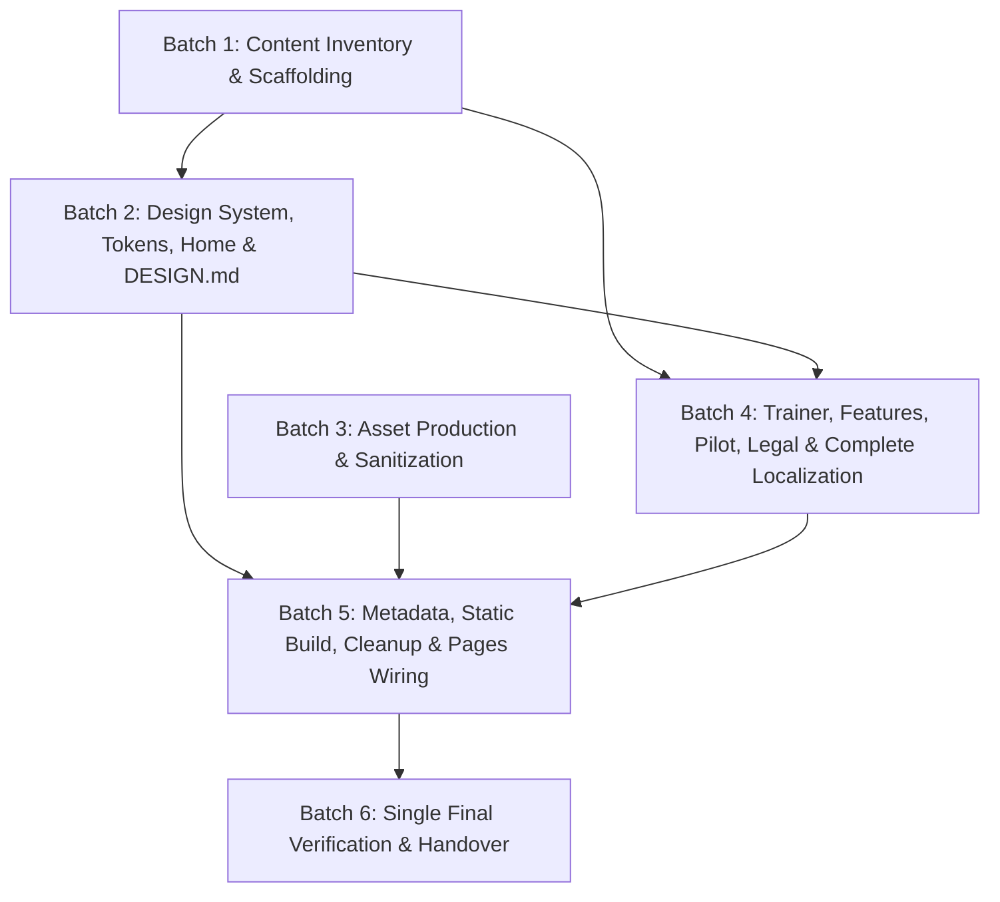

# SculptaLab Marketing Site Rebuild — Implementation Plan

- **Date:** 8 November 2026 (Europe/Amsterdam)
- **Authoritative Brief:** `docs/designs/2026-11-08-site-rebuild-brief.md`
- **Target Branch:** `site-rebuild-brief` (planning only; no site build or live Pages deployment from this branch)
- **Implementation Model Contract:** Planning refinement may use Argon; implementation **must use Composer 2.5 only (never fast)**.
- **Execution Environment Contract:** Mac is coding-only. Never run app, dev server, headless browser, or test processes on the Mac host. All build, asset rendering, static verification, and Lighthouse runs execute on `ai-node` or approved GitHub Actions CI. Build all implementation batches first without running test loops during coding; deploy to static Pages only after approval; run one small verification pass at the end.

---

## 1. Current Codebase Audit & Rebuild Delta

Inspection of the current repository (`base e5dc97e` plus brief commit on `site-rebuild-brief`) establishes the exact baseline that the rebuild replaces:

| Current File | Current Implementation & Problems | Rebuild Action |
|---|---|---|
| `index.html` (478 lines) | Single English-only page at root. Contains a blocking SVG `.loader` overlay, `<canvas class="aurora">`, scroll-scrubbed `.manifesto`, pinned 4-step `.story`, animated live-pose skeleton rep counter, fabricated `.trainer` dashboard (`trainer.sculptalab.com`, `"Send to Sanne’s Diet tab"`), outdated `"Coming soon"` cards for features now in pilot code, and fake Google Play / App Store download links. | **Remove / Replace** in Batch 5 after new multi-page static generator outputs root language chooser (`dist/index.html`) and localized routes (`dist/{nl,en}/...`). Preserve old `index.html` during Batches 1–4 until replacement is complete. |
| `src/main.js` (324 lines) | Imports `@fontsource-variable/inter`, `@fontsource/instrument-serif` (regular + italic), `gsap`, `gsap/ScrollTrigger`, and `lenis`. Runs a WebGL aurora shader loop, word-splitting DOM walkers (`[data-split]`), a 2.7s blocking intro timeline (`body.loading`, `opacity: 0` on hero/nav), 3D pointer parallax, pinned scroll triggers, 8+ `setInterval` loops mutating mockups every 300ms–5200ms, and a fake store toast (`"Early access — ask Vineeth for your private invite link ✨"`). | **Replace** in Batch 2 with a tiny progressive-enhancement module (`≤15 KB` gzip, targeting `<3 KB` gzip): language-switcher hash preservation, optional mobile `<details>` menu keyboard/escape polish, and optional reduced-motion-safe intersection observer if needed. Remove `gsap` and `lenis` in Batch 5. |
| `src/style.css` (494 lines) | Monolithic, desktop-first stylesheet (`@media (max-width: 980px)` and `@media (max-width: 560px)` overrides). Uses `hero-title` `clamp(56px, 9.2vw, 148px)`, `min-height: 100svh`, `.nav nav { display: none }` on mobile with no menu fallback, sticky 62vh mobile story pinning with `margin-bottom: 46vh`, and `zoom: .56` hacks on `.hero-phone`. | **Replace** in Batch 2 with modular mobile-first CSS (`src/styles/{tokens,base,layout,components}.css`, total `≤30 KB` gzip) using `min-width` media queries (`768px`, `1024px`). Delete `src/style.css` in Batch 5. |
| `package.json` & `package-lock.json` | `"type": "commonjs"`, depends on `gsap@^3.15.0`, `lenis@^1.3.27`, `@fontsource-variable/inter@^5.3.0`, `@fontsource/instrument-serif@^5.3.0`; devDependencies `puppeteer-core@^24.43.1`, `vite@^5.4.21`. `"test"` script intentionally exits 1. | **Modify** in Batch 1 (add build-time page generation script) and Batch 5 (remove `gsap`, `lenis`, and unused font weights; wire `render-pages`, `metadata`, and `check-static` into `npm run build`; keep `puppeteer-core` dev-only). |
| `vite.config.js` (2 lines) | Single-input config reading `process.env.BASE \|\| "/"`, `build.target: "es2020"`. | **Modify** in Batch 1 & Batch 5 to pass explicit `build.rollupOptions.input` entries for all generated static HTML pages (root chooser, `404.html`, and all `/nl/*` and `/en/*` routes) while preserving `base: process.env.BASE \|\| "/"`. |
| `scripts/shots.mjs` & `scripts/assets.mjs` | Hard-code `executablePath: "/usr/bin/google-chrome"` and `--no-sandbox`. `shots.mjs` captures 14 old desktop + 14 mobile screenshots of the deleted scroll-film sections. | **Replace / Refactor** in Batch 3 & Batch 5: resolve browser via `process.env.CHROME_PATH` or standard OS paths without hard-coded `/usr/bin/google-chrome` or default `--no-sandbox` in interactive runs; replace `shots.mjs` with the lightweight 4-screenshot verification helper in Batch 6. |
| `.github/workflows/deploy.yml` | Runs only on `push.branches: [main]` and `workflow_dispatch`; builds with `BASE: /sculptalab-site/` and immediately deploys in a dependent job. | **Modify** in Batch 5: add `pull_request` trigger for build + `check-static` + artifact validation only; gate `configure-pages`, `upload-pages-artifact`, and `deploy-pages` strictly to `main` pushes or manual `main` dispatch with job-level least-privilege permissions. |
| `public/*` | Contains `favicon.svg`, `favicon-32.png`, `apple-touch-icon.png`, `icon-192.png`, `icon-512.png`, `icon.png`, `hero-figure.webp`, `og.png`, `robots.txt`, `site.webmanifest`. | **Keep** `favicon.svg` and icon family (`A12`); update `site.webmanifest` and generated `robots.txt`/`sitemap.xml` in Batch 5 for base-path awareness; add `public/.nojekyll` and `public/images/{hero,anatomy,screens,lifestyle}/` in Batches 3 & 5. |

---

## 2. Mobile-First & Lighthouse 90+ Engineering Contract

Scoring **≥90 on Lighthouse Mobile Performance** (and aiming for **≥95 Accessibility and SEO**), with **LCP < 2.5s**, **CLS < 0.1**, and **INP < 200ms**, is a non-negotiable architectural constraint across every batch.

### 2.1 Resource & Transfer Budgets (Mobile Throttled Navigation)
- **Initial mobile transfer size:** `≤ 450 KB` total compressed (HTML + CSS + JS + critical WOFF2 font + hero image `A01` mobile variant).
- **First-party JavaScript:** `≤ 15 KB` gzip (`0 KB` third-party scripts, `0` WebGL contexts, `0` animation libraries).
- **Stylesheets:** `≤ 30 KB` gzip combined across `tokens.css`, `base.css`, `layout.css`, and `components.css`.
- **Fonts:** `≤ 80 KB` combined WOFF2 (`Inter Variable` Latin/Latin-ext subset containing Dutch diacritics `ë, ï, é, è, ö, ü, ij` preloaded; `Instrument Serif Italic` loaded lazily/below-fold or subsetted to editorial accent glyphs only, never competing with the hero LCP request).
- **Image payload ceilings (mobile crop):**
  - `A01` (hero-app, 4:5 portrait, 480w/768w): `≤ 140 KB` (`fetchpriority="high"`, `loading="eager"`, `decoding="async"`).
  - `A02` (plan, 3:4): `≤ 100 KB` (`loading="lazy"`).
  - `A03` (workout, 3:4): `≤ 100 KB` (`loading="lazy"`).
  - `A04` (muscle-front & muscle-back, 4:5): `≤ 160 KB` per view (`loading="lazy"` on home; front view `eager` only if placed above fold on a subroute).
  - `A05` (studio-overview, 4:5 mobile crop / 16:10 desktop): `≤ 160 KB` (`loading="lazy"`).
  - `A06` (form-preview, 4:5): `≤ 130 KB` (`loading="lazy"`).
  - `A07` (movement-guide, 4:3): `≤ 90 KB` (`loading="lazy"`).
  - `A08` (trainer-conversation, 4:5 mobile crop / 3:2 desktop): `≤ 130 KB` (`loading="lazy"`).
  - `A09` (trainer-dashboard, 4:5 mobile crop / 16:10 desktop): `≤ 140 KB` (`loading="lazy"`, eager with `fetchpriority="high"` when used as above-fold visual on `/nl/trainers/` and `/en/trainers/`).
  - `A10` (pilot-gym, 4:5 mobile crop / 16:9 desktop): `≤ 120 KB` (pilot route only).
  - `A11` (`og-nl.jpg`/`png` and `og-en.jpg`/`png`, 1200×630): `≤ 250 KB` JPEG/PNG (never AVIF for social crawler compatibility).
  - **Total homepage lazy image set:** `≤ 1.5 MB`.

### 2.2 Mobile-First Layout & Viewport Rules
1. **Base CSS targets `320px–767px` without media queries:**
   - Single-column flow (`display: flex; flex-direction: column` or `1fr` grid).
   - Horizontal gutters: `16px` at `320px–359px`, `20px` at `360px–767px`.
   - Body typography: `16px–18px` (`1rem–1.125rem`), `line-height: 1.5–1.6`, max measure `65ch`.
   - Touch targets: minimum `44×44px` (`48px` height for primary/secondary buttons, nav links, `<summary>` toggles, and language switcher links).
   - Vertical section rhythm: `56px–72px` on mobile (`80px–112px` at `≥1024px`).
   - Hero heading (`h1`): `clamp(2.5rem, 7vw, 3rem)` (`40px–48px`) on mobile; `clamp(4rem, 5.5vw, 4.75rem)` (`64px–76px`) at `≥1024px`. Never inherit giant desktop sizes onto phones.
   - Zero `min-height: 100vh` / `100svh` traps that clip content on short or landscape mobile viewports.
   - Safe-area insets (`env(safe-area-inset-bottom)`, `env(safe-area-inset-left/right)`) respected on any sticky rail or header; sticky elements must never obscure footer, legal, or consent text.
2. **First Viewport (Mobile 390×844 & 320×568):**
   - `64px` sticky/static header containing brand mark + wordmark, visible `NL / EN` switch, and compact native `<details>` menu for secondary links (`Product`, `For trainers`, `All features`, `Pilot`).
   - Above the hero image on mobile: pilot eyebrow → 3-line H1 → 2-line explanation → full-width primary CTA (`Request a trainer demo` / `Vraag een trainersdemo aan`) → secondary CTA (`Explore the app` / `Bekijk de app`) → honest availability microcopy → single portrait hero visual (`A01`).
   - Primary CTA must **never** be hidden inside a closed mobile menu.
3. **Zero CLS & Zero Render-Blocking Gates:**
   - Every `` and `<source>` must declare explicit `width` and `height` attributes matching its intrinsic aspect ratio (`4:5`, `3:4`, `16:10`, `4:3`, `3:2`, `16:9`).
   - Never load both mobile and desktop images and toggle `display: none` in CSS; use `<picture>` with `<source media="(min-width: 768px)" ...>` and `<source type="image/avif">` / `<source type="image/webp">` with exact `srcset` and `sizes`.
   - Every element is rendered at `opacity: 1; transform: none` in initial HTML/CSS. No JS loader gate. Optional decorative transitions are capped at `160–220ms` (`opacity`/`transform` only) and disabled under `@media (prefers-reduced-motion: reduce)`.
   - Zero horizontal overflow (`document.documentElement.scrollWidth <= window.innerWidth`) at `320px`, `390px`, `768px`, and `1440px`, and at `200%` browser text zoom.

---

## 3. Batch Dependency & Parallelism Matrix



| Batch | Title | Depends On | Can Run in Parallel? | Parallel Partner(s) & File-Lock Boundary |
|---|---|---|---|---|
| **Batch 1** | Content inventory and scaffolding | None (Brief §1–§10) | **Yes** | Runs in parallel with **Batch 3** (and initial token authoring of **Batch 2**). Batch 1 owns `docs/content/feature-manifest.json`, `src/content/{nl,en}.json`, `scripts/render-pages.mjs`, `src/templates/{page,sections}.html`, `vite.config.js`, `package.json`. |
| **Batch 2** | Design system, home route, and `DESIGN.md` | **Batch 1** (template engine & home dictionary keys) | **Yes** | Runs in parallel with **Batch 3** (using aspect-ratio-reserved image paths from the asset contract) and can overlap with **Batch 4** once `src/styles/{tokens,base,layout,components}.css` and `src/templates/page.html` are locked. Owns `src/styles/*.css`, `src/templates/home.html`, `src/main.js`, `DESIGN.md`. |
| **Batch 3** | Asset production and sanitization | None (Brief §6 palette & §7 asset specs + owner screenshot review) | **Yes** | Runs in parallel with **Batches 1, 2, and 4**. Owns `public/images/{hero,anatomy,screens,lifestyle}/`, `scripts/images.mjs`, `scripts/assets.mjs`, `docs/assets/site-image-manifest.json`. |
| **Batch 4** | Trainer, features, pilot, legal/contact routes and complete localization | **Batch 1** (manifest & page renderer) + **Batch 2** (shared CSS & page layout shell) | **Yes** | Runs in parallel with **Batch 3** (and in parallel with Batch 2's `home.html` once shared CSS/layout shell is committed). Owns `src/templates/{trainers,features,pilot,legal,contact}.html` and route-specific namespaces in `src/content/{nl,en}.json`. |
| **Batch 5** | Metadata, static build, legacy cleanup, and Pages wiring | **Batches 1, 2, 3, 4** | **No** (Integration Gate) | Sequential integration step. Finalizes `vite.config.js`, `package.json`, `scripts/{metadata,check-static}.mjs`, root/404 templates, `public/site.webmanifest`, `robots.txt`, `sitemap.xml`, localized OG cards (`A11`), `.github/workflows/deploy.yml`, `README.md`, and deletes legacy `index.html`, `src/style.css`, GSAP, and Lenis. |
| **Batch 6** | Single final lightweight verification and handover | **Batch 5** + authorized staging/Pages deploy | **No** (Verification Gate) | Sequential final pass on `ai-node` / CI after approved deployment. Produces `docs/build/site-rebuild-check.md` and at most 4 sanitized screenshots. |

---

## 4. Detailed Build Batches

### Batch 1: Content Inventory and Scaffolding

- **Dependencies:** None (uses `docs/designs/2026-11-08-site-rebuild-brief.md` §3, §4, §5, §8).
- **Can Run in Parallel:** **Yes** — can execute in parallel with **Batch 3 (Asset production and sanitization)** because asset IDs (`A01`–`A12`), aspect ratios, and target paths (`public/images/...`) are fixed by contract.
- **Files:**
  - Create: `docs/content/feature-manifest.json`
  - Create: `src/content/en.json`
  - Create: `src/content/nl.json`
  - Create: `scripts/render-pages.mjs`
  - Create: `src/templates/page.html`
  - Create: `src/templates/sections.html`
  - Modify: `.gitignore` (ignore generated build-time HTML staging directory, e.g., `.generated/` or `.pages/`)
  - Modify: `vite.config.js` (configure multi-page inputs from generated staging directory while preserving existing site until Batch 5 cutover)
  - Modify: `package.json` and `package-lock.json` (add `"render:pages": "node scripts/render-pages.mjs"`, ensure ESM compatibility)
  - Modify: `README.md` (document content manifest and multi-page generation scaffolding)

#### Implementation Tasks
1. **Author `docs/content/feature-manifest.json`:**
   - Encode every row from Brief §4 into a structured JSON array. Each entry must include:
     - `id` (stable slug, e.g., `onboarding-plan`, `workout-player`, `activity-logging`, `progress-scores`, `muscle-intelligence`, `exercise-learn`, `form-analysis-preview`, `daily-timers-bubble`, `health-connections`, `studio-dashboard`, `studio-blocks-insights`, `studio-body`, `nutrition-education`, `trainer-consent-sharing`, `trainer-queue`, `group-sessions-preview`, `account-billing-settings`, `additional-legacy-views`, `studio-lab-research`, `planned-roadmap`, `bilingual-nl-en`).
     - `category` (`training`, `progress`, `muscles`, `studio`, `trainers`, `learning`, `connections`, `planned`).
     - `homeSectionAnchor` (`#plan`, `#train`, `#progress`, `#muscles`, `#learn`, `#form`, `#daily`, `#studio`, `#trainers`, `#roadmap`, `#faq`, or `null` for catalogue-only rows).
     - `status` (`in_pilot` → `"In the pilot" / "In de pilot"`, `preview` → `"Preview" / "Voorproefje"`, `planned` → `"Planned" / "Gepland"`).
     - `platforms` (array of `"android_pilot"`, `"web_studio"`, `"trainer_web"`, `"planned_ios"`, `"planned_watch"` with explicit caveats).
     - `evidencePaths` (exact app repository paths from Brief §4, e.g., `apps/mobile/app/...`, `apps/web/src/app/studio/(hub)/...`).
     - `truthCaveatKey` (link to `src/content/{en,nl}.json` caveat copy).
   - Explicitly exclude fixture/debug routes (`muscle-coverage-fixture`, debug controls, auth bypasses) and collapse route aliases.
2. **Author `src/content/en.json` and `src/content/nl.json`:**
   - Shared schema with identical key hierarchy across both locales; zero runtime i18n JSON shipped to the browser.
   - Include configuration block:
     ```json
     "config": {
       "play": null,
       "ios": null,
       "publicStudio": null,
       "demoEmail": null
     }
     ```
   - Include complete draft translations from Brief §3, §4, §5, §7, and §9:
     - Navigation (`Product` / `Product`, `For trainers` / `Voor trainers`, `All features` / `Alle functies`, `Pilot` / `Pilot`, language switch labels `English` and `Nederlands`, primary CTA `Request a trainer demo` / `Vraag een trainersdemo aan`).
     - All 10 homepage sections (`#top`, `#trainers`, `#plan`, `#train`, `#muscles`, `#progress`, `#studio`, `#form`, `#learn`, `#daily`, `#roadmap`, `#faq`, `#pilot`).
     - Status badges (`In the pilot` / `In de pilot`, `Preview` / `Voorproefje`, `Planned` / `Gepland`, `Android only` / `Alleen Android`, `Illustrative app preview` / `Illustratieve appweergave`).
     - Alt text, figure captions, aria-labels, meta titles/descriptions, footer disclaimers, and pending-contact / non-link store placeholder strings (`"Google Play — not yet public"` / `"Google Play — nog niet openbaar"`, `"App Store — planned"` / `"App Store — gepland"`, `"Demo contact details will be added here"` / `"Contactgegevens voor een demo volgen hier"`).
   - Enforce all Truth Rules (Brief §1): no clinical validation, injury prevention, recovery %, guaranteed muscle growth, body scan claims, left/right asymmetry/valgus diagnosis, fake ratings/testimonials/prices, or "three questions" / fixed exercise count promises.
3. **Build `scripts/render-pages.mjs` and base templates (`src/templates/{page,sections}.html`):**
   - Pure Node.js build-time script (no client framework) that reads `docs/content/feature-manifest.json` and `src/content/{nl,en}.json`, validates that every key in `en.json` exists in `nl.json` (and vice versa) and that every manifest row has translations, then outputs static HTML pages with trailing-slash directory structure:
     - `/` (`index.html` — accessible bilingual language chooser with Dutch prominently offered)
     - `/404.html`
     - `/nl/index.html`, `/en/index.html`
     - `/nl/trainers/index.html`, `/en/trainers/index.html`
     - `/nl/features/index.html`, `/en/features/index.html`
     - `/nl/pilot/index.html`, `/en/pilot/index.html`
     - `/nl/privacy/index.html`, `/en/privacy/index.html`
     - `/nl/terms/index.html`, `/en/terms/index.html`
     - `/nl/contact/index.html`, `/en/contact/index.html`
   - Ensure all internal links and asset URLs prepend `BASE` (`process.env.BASE || "/"`).

#### Acceptance Checks
- [ ] `node scripts/render-pages.mjs` validates parity between `src/content/en.json`, `src/content/nl.json`, and `docs/content/feature-manifest.json` with zero missing keys.
- [ ] Every row in Brief §4 is present in `docs/content/feature-manifest.json` with `evidencePaths`, `status`, `platforms`, and EN/NL copy; zero test/fixture routes are included.
- [ ] Generated nested static HTML files exist for all required `/nl/*` and `/en/*` routes, root chooser, and `404.html`.
- [ ] Setting `play`, `ios`, `publicStudio`, and `demoEmail` to `null` renders honest non-link text and in-page explanations without broken `href=""` or `#` anchors.
- [ ] Old site files remain intact until Batch 5 cutover.

---

### Batch 2: Design System, Home Route, and `DESIGN.md`

- **Dependencies:** **Batch 1** (`scripts/render-pages.mjs`, `src/content/{nl,en}.json`, `src/templates/{page,sections}.html`).
- **Can Run in Parallel:** **Yes** — runs in parallel with **Batch 3 (Asset production)** using deterministic aspect-ratio containers and target `/images/...` paths; can run in parallel with **Batch 4** once `src/styles/{tokens,base,layout,components}.css` and `src/templates/page.html` are finalized.
- **Files:**
  - Create: `src/styles/tokens.css`
  - Create: `src/styles/base.css`
  - Create: `src/styles/layout.css`
  - Create: `src/styles/components.css`
  - Create: `src/templates/home.html`
  - Modify: `src/templates/page.html` and `src/templates/sections.html`
  - Modify: `src/main.js` (replace WebGL/GSAP/Lenis/loader/living-mockups with minimal progressive enhancement)
  - Create: `DESIGN.md` (codifying the design system, token provenance from `packages/ui-tokens`, typography, anatomy stage rules, and mobile-first layout specs per Brief §2 & §6)

#### Implementation Tasks
1. **Create `src/styles/tokens.css` (Brief §6):**
   - Map exact app dark tokens and document provenance from `packages/ui-tokens/src/index.ts`:
     - Canvas & surfaces: `--bg-canvas: #120D0B`, `--bg-surface: #1C1512`, `--bg-elevated: #2A211D`, `--border-subtle: rgba(255, 255, 255, 0.09)`, `--border-strong: rgba(255, 255, 255, 0.16)`.
     - Text: `--text-primary: #F5ECE6`, `--text-secondary: #C4B3A8`, `--text-on-brand: #1A110D` (verify ≥ 4.5:1 WCAG AA contrast on `#FF7A3D`).
     - Brand action: `--brand-orange: #FF7A3D`, `--brand-coral: #FF5E6C`.
     - Anatomy stage tokens (isolated to `.stage-anatomy`, never leaked as random page glows, and **zero theme-orange inside the anatomy stage**):
       - `--anatomy-bg: #07080B`, `--anatomy-neutral: #1A1D24`, `--anatomy-inactive-start: #2A1418`, `--anatomy-inactive-end: #1E1A20`, `--anatomy-rim: #CFE3FF`.
       - Muscle neon identities: `--mi-glutes: #B44DFF`, `--mi-quads: #FF3B5C`, `--mi-hamstrings: #FFB020`, `--mi-calves: #3DFF8A`, `--mi-core: #6C63FF`, `--mi-back: #22D3EE`, `--mi-shoulders: #FF5FA2` (or `#FF7A59` only if visually distinct from brand orange; prefer `#FF5FA2` inside stage to avoid orange ambiguity), `--mi-arms: #F472B6`, `--mi-serratus: #3B82F6`.
     - Spacing, typography, and breakpoints (`320px`, `768px`, `1024px`, max container `1200px`).
2. **Create `src/styles/base.css`, `src/styles/layout.css`, `src/styles/components.css` (Mobile-First):**
   - Self-hosted `@font-face` declarations for `Inter Variable` (Latin + Latin-ext WOFF2, `font-display: swap`) and `Instrument Serif Italic` (editorial accent only, `font-display: swap`), with metric-compatible fallback stacks so font swap produces `< 0.01` CLS.
   - Mobile-first layout rules (`320px–767px` default):
     - `.site-header`: `64px` height, `16px`/`20px` padding, flex row with logo, language switch (`NL` / `EN`), primary CTA button (or persistent mobile top/bottom CTA bar), and native `<details class="nav-drawer">` menu.
     - `.container`: `width: 100%; padding-inline: 16px` (`@media (min-width: 360px) { padding-inline: 20px }`, `@media (min-width: 1024px) { max-width: 1200px; margin-inline: auto; padding-inline: 32px }`).
     - `.grid-12`: 1 column on mobile, 2 columns at `@media (min-width: 768px)`, 12-column CSS grid at `@media (min-width: 1024px)`.
   - Component styles:
     - Buttons (`.btn-primary`, `.btn-secondary`) with `min-height: 48px`, `padding: 12px 20px`, high-contrast focus ring (`:focus-visible { outline: 2px solid var(--brand-orange); outline-offset: 3px }`).
     - Status badges (`.badge-pilot`, `.badge-preview`, `.badge-planned`, `.badge-platform`) using both border/pattern and text labels (never color alone).
     - Anatomy stage (`.anatomy-stage`): full-bleed `#07080B` container, mobile view-switcher using native `<details>` or anchor-targeted tabs (`Front / Voorzijde` and `Back / Achterzijde`) with zero hover dependence, and real HTML `<ul class="muscle-legend">` where each muscle group displays a patterned/shaped swatch + localized name.
     - FAQ accordion (`.faq-list details`): native `<details>`/`<summary>`, all 6 closed by default, keyboard operable, `48px` minimum summary tap height.
3. **Implement `src/templates/home.html` (Brief §5, Sections 01–10):**
   - Implement exact section order and stable anchor IDs:
     1. **01 Header + Hero (`#top`)**: Eyebrow, H1 (`Make every workout easier to understand.` / `Krijg meer inzicht in elke training.`), 2-line body, primary CTA (`Request a trainer demo` → `/<lang>/pilot/`), secondary CTA (`Explore the app` → `#train`), microcopy + app translation refinement note, and portrait visual `A01` with `"Illustrative app preview"` caption. Desktop layout: 5/12 copy, 7/12 visual, actions above fold. Mobile layout: copy and CTAs above `A01`.
     2. **02 Trainer bridge (`#trainers`)**: Placed immediately after hero. Warm neutral band, H2 (`A better conversation at the gym.`), body, 3 numbered steps (`Client chooses what to share → Trainer reviews → Discuss the next session`), photo `A08`, CTA to `/<lang>/trainers/`, and pilot workflow caption.
     3. **03 Plan and train (`#plan`, `#train`)**: 3 compact numbered static rows (no pinned scroll story) with `A02` and `A03` crops, supporting line for strength/cardio/calendar, CTA to `/<lang>/features/#training`.
     4. **04 Muscle Intelligence (`#muscles`)**: Near-black `#07080B` stage, static exported image `A04` (front/back switch without WebGL), HTML legend for all 8 muscle groups, explicit training-based estimate disclaimer, CTA to `/<lang>/features/#muscles`.
     5. **05 Progress and Studio (`#progress`, `#studio`)**: Authentic sanitized Studio crop `A05`, 3 compact editorial columns (`Strength & records`, `Volume & consistency`, `Reports & insights`), CTA to `/<lang>/features/#studio`. No `homelab.local` or unverified public Studio login URL.
     6. **06 Form preview (`#form`)**: Phone capture `A06`, mandatory adjacent `Preview / Voorproefje` badge, supported-movement caveat, medical/trainer footnote, CTA to `/<lang>/pilot/#availability`. No animated synthetic rep counters.
     7. **07 Learning and everyday details (`#learn`, `#daily`)**: 6 icon-led compact items + `A07` movement guide image; explicit `Android` badge on the floating workout bubble; CTA to `/<lang>/features/`.
     8. **08 Honest roadmap (`#roadmap`)**: Narrow text-first two-column comparison separating `In the pilot` core features from `Planned` items, with link to `/<lang>/features/#planned`.
     9. **09 FAQ (`#faq`)**: 6 native `<details>` items (closed by default) with exact honest answers from Brief §5.09.
     10. **10 Pilot CTA, store placeholders & footer (`#pilot`)**: H2, guided demo explanation, honest contact placeholder (when `demoEmail: null`), non-link store status indicators (`Google Play — not yet public`, `App Store — planned`), and footer with bilingual legal/contact links, copyright year in static HTML, and demo-data disclaimer.
4. **Replace `src/main.js`:**
   - Strip all WebGL, GSAP, ScrollTrigger, Lenis, word splitters, loader gates, and `setInterval` mockup loops.
   - Implement only:
     - Language switcher hash preservation: when clicking the header language switch link, if `window.location.hash` matches an anchor ID present on the target locale page (`#top`, `#trainers`, `#plan`, `#train`, `#muscles`, `#progress`, `#studio`, `#form`, `#learn`, `#daily`, `#roadmap`, `#faq`, `#pilot`), append the hash to the switcher `href`.
     - Mobile `<details>` navigation enhancement: close the `<details>` menu on `Escape` key or when clicking an in-page anchor link inside it.
5. **Write `DESIGN.md`:**
   - Document brand thesis, color tokens and `packages/ui-tokens` mapping, anatomy stage isolation rules, typography scale, mobile-first grid/spacing system, accessibility requirements, and asset ratios.

#### Acceptance Checks
- [ ] All homepage story sections, CTAs, FAQ answers, and disclaimers render completely and legibly with **JavaScript disabled**.
- [ ] Exactly one `<h1>` exists on `/nl/` and `/en/`; heading hierarchy (`h1` → `h2` → `h3`) has zero skipped levels.
- [ ] All required homepage section IDs (`#top`, `#trainers`, `#plan`, `#train`, `#muscles`, `#progress`, `#studio`, `#form`, `#learn`, `#daily`, `#roadmap`, `#faq`, `#pilot`) exist in the DOM.
- [ ] On mobile (`320×568` and `390×844`), the primary trainer CTA (`Request a trainer demo` / `Vraag een trainersdemo aan`) appears above the hero image `A01` and is visible outside any collapsed menu.
- [ ] Zero horizontal scrollbar (`scrollWidth === clientWidth`) at viewport widths `320px`, `390px`, `768px`, and `1440px`, and at `200%` text zoom.
- [ ] Enabling `prefers-reduced-motion: reduce` causes zero content loss or visibility change.
- [ ] Total compiled CSS is `≤ 30 KB` gzip and compiled `src/main.js` is `≤ 15 KB` gzip.

---

### Batch 3: Asset Production and Sanitization

- **Dependencies:** Brief §6 (palette) and §7 (asset inventory `A01`–`A12` & screenshot shortlist). Independent of Batches 1, 2, and 4 code implementation.
- **Can Run in Parallel:** **Yes** — runs in parallel with **Batches 1, 2, and 4**.
- **Files:**
  - Create: `docs/assets/site-image-manifest.json`
  - Create: `scripts/images.mjs`
  - Modify: `scripts/assets.mjs` (replace hard-coded `/usr/bin/google-chrome` and default `--no-sandbox` with portable `CHROME_PATH` discovery; support deterministic HTML/SVG compositing for `A11` localized OG images `public/og-nl.png` and `public/og-en.png`)
  - Create outputs in:
    - `public/images/hero/` (`A01` in 480w, 768w, 1200w `.avif` and `.webp`)
    - `public/images/anatomy/` (`A04` front and back views in 480w, 800w, 1200w `.avif` and `.webp`)
    - `public/images/screens/` (`A02`, `A03`, `A05`, `A06`, `A07`, `A09` in responsive widths `.avif` and `.webp`)
    - `public/images/lifestyle/` (`A08`, `A10` in 480w, 800w, 1280w `.avif` and `.webp`)
    - `public/og-nl.png` (or `.jpg`) and `public/og-en.png` (or `.jpg`) (`A11`, 1200×630, `≤ 250 KB`)

#### Implementation Tasks
1. **Audit & Sanitize Source Screenshots (Brief §7):**
   - Inspect candidate screenshots from the app repository (`/workspace/sculptalab/docs/build/visual-qa-2026-11-08/...`) on `ai-node`:
     - `systest/02_home.png` (`A05` Studio overview candidate)
     - `systest/05_plan.png` (`A02` plan candidate)
     - `systest/04_workouts_sessions.png` & `04b_workouts_activities.png` (features history reference)
     - `systest/03_progress.png` & `03b_progress_mi_hero.png` (progression reference)
     - `mi-anatomy-v4/laptop-front.png`, `laptop-back.png`, `mobile-front.png`, `laptop-hover-glutes.png` (`A04` candidates — **verify visible body, working shader, non-overlapping labels, and zero blank-body bug before using**; never publish a blank or broken capture just because its path says `v4`).
   - Strip all personal/account identifiers (no `"Vineeth"`, real email addresses, real trainer names, `homelab.local` URLs, or auth tokens). Use fictional, clearly labelled demo personas (e.g., `"Sanne (Demo)"`) and deterministic HTML/SVG overlays with real `Inter Variable` typography.
2. **Produce & Composite Assets `A01`–`A12`:**
   - Generate background/device frames without AI-generated UI text, then composite verified sanitized screens or deterministic HTML/SVG UI layers:
     - `A01` (`hero-app`): 4:5 mobile (`480w`, `768w`) and 16:10 desktop (`1200w`), mobile `≤ 140 KB`.
     - `A02` (`plan`): 3:4 (`400w`, `640w`, `960w`), mobile `≤ 100 KB`.
     - `A03` (`workout`): 3:4 (`400w`, `640w`, `960w`), mobile `≤ 100 KB`.
     - `A04` (`muscle-front`, `muscle-back`): 4:5 (`480w`, `800w`, `1200w`), mobile `≤ 160 KB` per view; deterministic leader lines/labels outside body safe area; zero theme-orange (`#FF7A3D`) inside anatomy stage.
     - `A05` (`studio-overview`): 4:5 mobile crop and 16:10 desktop (`640w`, `960w`, `1440w`), mobile `≤ 160 KB`.
     - `A06` (`form-preview`): 4:5 (`480w`, `768w`, `1200w`), mobile `≤ 130 KB`, deterministic vector pose trace and preview badge overlay.
     - `A07` (`movement-guide`): 4:3 (`400w`, `640w`, `960w`), mobile `≤ 90 KB`.
     - `A08` (`trainer-conversation`): 4:5 mobile crop and 3:2 desktop (`480w`, `800w`, `1280w`), mobile `≤ 130 KB`.
     - `A09` (`trainer-dashboard`): 4:5 mobile crop and 16:10 desktop (`480w`, `800w`, `1280w`), mobile `≤ 140 KB`, fictional client and explicit consent scope indicator.
     - `A10` (`pilot-gym`): 4:5 mobile crop and 16:9 desktop (`480w`, `800w`, `1280w`), mobile `≤ 120 KB`, no QR code in photo.
     - `A11` (`og-nl`, `og-en`): 1200×630 deterministic social cards rendered via `scripts/assets.mjs`, `≤ 250 KB` PNG/JPEG.
     - `A12` (`logo/favicon`): reuse existing `public/favicon.svg` and PNG icon set (`favicon-32.png`, `apple-touch-icon.png`, `icon-192.png`, `icon-512.png`).
3. **Build `scripts/images.mjs` and `docs/assets/site-image-manifest.json`:**
   - `scripts/images.mjs` verifies that every asset `A01`–`A12` exists in `public/`, checks dimensions, aspect ratios, and byte-size budgets, and validates `docs/assets/site-image-manifest.json`.
   - `docs/assets/site-image-manifest.json` records for every shipping image: `id`, `role`, `publicPaths` (AVIF/WebP/PNG), `dimensions`, `aspectRatio`, `maxMobileBytes`, `actualMobileBytes`, `provenance` (`modelOrTool`, `generationDate`, `promptSummary`, `sourceScreenshotCommit`, `sourceScreenshotPath`), `classification` (`synthetic_illustration` | `sanitized_app_composite` | `brand_mark`), `altKey`, `captionKey`, and `privacyReviewStatus` (`sanitized_demo_only`, `ownerPublishApproved`).

#### Acceptance Checks
- [ ] `node scripts/images.mjs` exits `0`, confirming all `A01`–`A12` files exist, match target dimensions/aspect ratios, and stay strictly within per-asset mobile KB budgets.
- [ ] `docs/assets/site-image-manifest.json` has complete provenance, synthetic-vs-real classification, alt/caption translation keys, and privacy sanitization status for every shipping raster.
- [ ] Visual inspection of `A04` confirms a visible anatomical body with working neon muscle segmentation, no blank shader output, no theme-orange in stage, and non-overlapping leader labels.
- [ ] Zero garbled AI text, zero personal/account data (`Vineeth`, real emails, private URLs), and zero unapproved raw QA captures exist in `public/`.
- [ ] `scripts/assets.mjs` has no hard-coded `/usr/bin/google-chrome` path and does not require `--no-sandbox` in standard local/interactive environments.

---

### Batch 4: Trainer, Features, Pilot, Legal/Contact Routes and Complete Localization

- **Dependencies:** **Batch 1** (`docs/content/feature-manifest.json`, `scripts/render-pages.mjs`, `src/content/{nl,en}.json`) and **Batch 2** (`src/styles/{tokens,base,layout,components}.css`, `src/templates/page.html`).
- **Can Run in Parallel:** **Yes** — runs in parallel with **Batch 3 (Asset production)** and can run in parallel with `src/templates/home.html` work in **Batch 2** once shared styles and `page.html` are committed.
- **Files:**
  - Create: `src/templates/trainers.html`
  - Create: `src/templates/features.html`
  - Create: `src/templates/pilot.html`
  - Create: `src/templates/legal.html`
  - Create: `src/templates/contact.html`
  - Modify: `src/content/en.json` and `src/content/nl.json` (complete all subroute copy, captions, status labels, and legal/contact pending states)
  - Modify: `docs/content/feature-manifest.json` and `scripts/render-pages.mjs` (wire subroute templates and category grouping)

#### Implementation Tasks
1. **Implement Trainer Route (`src/templates/trainers.html` → `/nl/trainers/`, `/en/trainers/`):**
   - Above-the-fold H1 (`"Coach the person, with their training in view."` / `"Coach de persoon, met inzicht in de training."`), primary CTA (`Request a trainer demo` / `Vraag een trainersdemo aan`), and hero visual `A09` (`fetchpriority="high"`, explicit width/height).
   - Implement all 8 required sections from Brief §5 ("Trainer detail route"):
     1. Guided pilot promise (what trainers can demonstrate on the gym floor today).
     2. Trainer sign-in & onboarding (`trainer/sign-in`, `trainer/onboarding`, `trainer/home`).
     3. Consent-first client sharing & scopes (`studio/share`, `s/[token]`, `trainer/c/[grantId]`, client-controlled scope, expiry, and instant revocation).
     4. Reviewing client sessions & progress together (shared workouts, volume, records, consistency).
     5. Form review queue preview (`trainer/queue` — explicitly badge AI form checker as `Preview / Planned`, not generally released).
     6. Group workspace preview (`trainer/group-sessions/[id]`, `studio/group/[id]` — route present as preview; explicitly do not claim live watch following, automated alerts, or full class orchestration).
     7. What is not yet public (no trainer-originated invite codes yet, no trainer-authored meal prescriptions or remote plan pushing claimed as shipped).
     8. Guided demo checklist & CTA (links to `/<lang>/pilot/`).
2. **Implement Features Catalogue Route (`src/templates/features.html` → `/nl/features/`, `/en/features/`):**
   - Mobile-first sticky category navigation bar (`#training`, `#progress`, `#muscles`, `#studio`, `#trainers`, `#learning`, `#connections`, `#planned`) implemented with **wrapping flex/chip links** (`flex-wrap: wrap; gap: 8px`), never horizontal scrolling overflow.
   - Render every row from `docs/content/feature-manifest.json` (all 21 rows from Brief §4), including secondary/catalogue-only items (`Studio body`, `records`, `effort`, `Studio lab` research previews, `share-persona`/`share-outfit` & legacy routes under `"Additional views"`, `billing/settings` under `"Account"`, and `"Other pilot tools"`).
   - Each feature card displays: localized title, honest description, status badge (`In the pilot`, `Preview`, or `Planned`), platform badges (`Android pilot`, `Web Studio`, `Trainer Web`), and explicit caveat note.
   - Ensure `Studio lab` (`forecasts`, `PR prediction`, `change-points`, `clustering`, `correlations`, `monotony/strain`, `camera velocity`) is clearly marked as hidden/experimental research previews, not available user capabilities.
   - Ensure health connections (`Health Connect`, `HealthKit`, `Strava`) state source provenance/duplicate handling without implying universal smartwatch support.
3. **Implement Pilot Route (`src/templates/pilot.html` → `/nl/pilot/`, `/en/pilot/`):**
   - Visual `A10` (`pilot-gym`) and step-by-step walkthrough:
     `Trainer-led demo → Supervised Android setup → Consent & sharing scope discussion → First training session → Pilot feedback`.
   - Include `#availability` anchor detailing current pilot flags (`liveCamera: false`, `formScoring: false`, `premium: false` by default unless enabled in supervised demo) and honest launch prerequisites (public HTTPS app origin, backup/restore verification, finalized legal/privacy terms, trainer invite flow, error monitoring, native Dutch app review, and public store rollout).
   - **Zero health-data intake form** on static GitHub Pages. When `config.demoEmail` is `null`, show the explicit pending-contact notice (`"Demo contact details will be added here"` / `"Contactgegevens voor een demo volgen hier"`) and in-page explanation of how the guided demo works.
4. **Implement Legal & Contact Routes (`src/templates/legal.html`, `src/templates/contact.html`):**
   - Generate `/nl/privacy/`, `/en/privacy/`, `/nl/terms/`, `/en/terms/`, `/nl/contact/`, `/en/contact/`.
   - Legal pages must display a prominent, unmistakable status banner: **Draft / Pending Owner & Legal Review before accepting real pilot health data** (never masquerade placeholder text as finalized legal compliance or invent a KvK number, street address, or DPO contact).
   - Contact page renders honest pilot contact state (using `config.demoEmail` only when configured, otherwise the pending notice) with zero unconnected `<form>` elements or fake submission toasts.

#### Acceptance Checks
- [ ] Every table row in Brief §4 is rendered on `/nl/features/` and `/en/features/` with a localized title, description, platform badge, status badge, and `evidencePaths` reference in `docs/content/feature-manifest.json`.
- [ ] Switching languages via the header toggle on any route (`/nl/trainers/` ↔ `/en/trainers/`, `/nl/features/#muscles` ↔ `/en/features/#muscles`, `/nl/pilot/#availability` ↔ `/en/pilot/#availability`) navigates to the exact equivalent localized route and preserves matching section hashes.
- [ ] Sticky category index on `/nl/features/` and `/en/features/` wraps cleanly on a `320px` screen with zero horizontal overflow.
- [ ] Zero `<form>` elements, fake toast handlers, `mailto:` links to invented addresses, or counterfeit store badges exist on any route.
- [ ] Legal routes (`/nl/privacy/`, `/en/privacy/`, `/nl/terms/`, `/en/terms/`) clearly state their pending-review status and contain zero fabricated company registration numbers or addresses.

---

### Batch 5: Metadata, Static Build, Legacy Cleanup, and Pages Wiring

- **Dependencies:** **Batches 1, 2, 3, and 4**.
- **Can Run in Parallel:** **No** — sequential integration and packaging gate.
- **Files:**
  - Create: `src/templates/root.html` (accessible root language chooser for `/index.html`)
  - Create: `src/templates/404.html` (bilingual static 404 page for `/404.html`)
  - Create: `scripts/metadata.mjs` (generates `sitemap.xml`, `robots.txt`, `.nojekyll`, and base-aware `site.webmanifest`)
  - Create: `scripts/check-static.mjs` (validates built `dist/` routes, internal links, base paths, canonical/hreflang/OG tags, JSON-LD, Truth Rule forbidden phrases, dependency cleanliness, and byte budgets)
  - Modify: `vite.config.js` (wire all generated HTML inputs so `vite build` outputs `dist/index.html`, `dist/404.html`, `dist/nl/**/index.html`, `dist/en/**/index.html`)
  - Modify: `package.json` and `package-lock.json` (remove `gsap`, `lenis`, and unused `@fontsource` weights; set `"build": "node scripts/render-pages.mjs && vite build && node scripts/metadata.mjs && node scripts/check-static.mjs"`, `"test": "node scripts/check-static.mjs"`)
  - Modify: `public/site.webmanifest` (or generate via `scripts/metadata.mjs` so `start_url` and icon `src` respect `BASE`, and remove `display: "standalone"` offline-app pretension if inappropriate, using `"browser"`)
  - Modify: `.github/workflows/deploy.yml`
  - Modify: `README.md`
  - Delete: root `index.html` (replaced by generated root chooser at build time), `src/style.css` (replaced by `src/styles/*.css`), and obsolete `shots/*.png` if no longer referenced.

#### Implementation Tasks
1. **Implement Root Chooser (`src/templates/root.html`) and `404.html` (`src/templates/404.html`):**
   - Root `/index.html`: tiny, fast, accessible static page offering **Nederlands** (`/sculptalab-site/nl/`) and **English** (`/sculptalab-site/en/`) prominently with equal 48px touch targets. **Zero JS-only redirect and zero `navigator.language` forced rerouting.** Indexable with `hreflang="x-default"`, `hreflang="nl"`, and `hreflang="en"`.
   - `404.html`: static bilingual error page with base-aware links back to `/nl/` and `/en/`.
2. **Implement SEO, Social, and Structured Data Contract (`scripts/render-pages.mjs` + `scripts/metadata.mjs`, Brief §9):**
   - Single `SITE_URL` environment variable (default `https://vineethvijay.github.io/sculptalab-site/`, trailing-slash normalized) and `BASE` (default `/`, CI sets `/sculptalab-site/`).
   - Every route `<head>` includes:
     - Correct `<html lang="nl">` or `<html lang="en">`, `<meta charset="utf-8">`, `<meta name="viewport" content="width=device-width, initial-scale=1, viewport-fit=cover">`, `<meta name="theme-color" content="#120D0B">`.
     - Exact localized `<title>` and `<meta name="description">` from Brief §9 (e.g., Home EN: `"SculptaLab — Training insights for you and your trainer"`, Home NL: `"SculptaLab — Trainingsinzicht voor jou en je trainer"`, plus Trainer, Features, Pilot, Legal, and Contact titles).
     - `<meta name="robots" content="noindex, nofollow">` by default on preview/unapproved builds unless `ALLOW_INDEXING=true` is explicitly set after contact, availability, and legal copy are owner-approved (Brief §9: *"Preview deploys/artifacts noindex; production index only after contact, availability and legal copy approved"*).
     - Absolute `<link rel="canonical" href="...">` plus `<link rel="alternate" hreflang="nl" ...>`, `<link rel="alternate" hreflang="en" ...>`, and `<link rel="alternate" hreflang="x-default" ...>` (pointing to root chooser).
     - Localized Open Graph tags: `og:type="website"`, `og:title`, `og:description`, `og:url`, `og:image` (`SITE_URL + "og-nl.png"` or `"og-en.png"`), `og:image:width="1200"`, `og:image:height="630"`, `og:image:alt`, `og:locale` (`nl_NL` or `en_US`), and `og:locale:alternate`.
     - Twitter card: `twitter:card="summary_large_image"`, `twitter:title`, `twitter:description`, `twitter:image`, `twitter:image:alt`.
     - JSON-LD (`application/ld+json`) on home routes: `WebSite` + `SoftwareApplication` with `name: "SculptaLab"`, `applicationCategory: "HealthApplication"`, and honest operatingSystem/platform description; **omit** `offers`, `aggregateRating`, `review`, `downloadUrl`, and fake `Organization` postal addresses.
   - `scripts/metadata.mjs` writes `dist/.nojekyll`, `dist/sitemap.xml` (all canonical routes with `<xhtml:link rel="alternate" hreflang="..." />`), `dist/robots.txt` (pointing to `Sitemap: <SITE_URL>sitemap.xml`), and base-aware `dist/site.webmanifest`.
3. **Implement Static Verification Script (`scripts/check-static.mjs`):**
   - Asserts all expected HTML files exist in `dist/` (`index.html`, `404.html`, `nl/index.html`, `en/index.html`, `nl/trainers/index.html`, `en/trainers/index.html`, `nl/features/index.html`, `en/features/index.html`, `nl/pilot/index.html`, `en/pilot/index.html`, `nl/privacy/index.html`, `en/privacy/index.html`, `nl/terms/index.html`, `en/terms/index.html`, `nl/contact/index.html`, `en/contact/index.html`).
   - Parses every HTML file in `dist/` to verify:
     - Exactly one `<h1>` per page, `<main id="main">`, skip link, valid `lang`, `canonical`, `hreflang` (`nl`, `en`, `x-default`), and OG metadata.
     - Every internal `href`, `src`, and `srcset` resolves to an existing file in `dist/` when stripped of `BASE`.
     - Zero references to `homelab.local`, `localhost`, `trainer.sculptalab.com`, `GLUTE4ALL`, or forbidden marketing claims (`clinically validated`, `injury prevention`, `guaranteed muscle growth`, `body scan`, `three questions`).
     - Asset & bundle budgets: JS gzip `≤ 15 KB`, CSS gzip `≤ 30 KB`, fonts `≤ 80 KB`, hero mobile image `≤ 140 KB`, initial mobile transfer `≤ 450 KB`.
4. **Update `.github/workflows/deploy.yml` (Brief §10):**
   - Triggers:
     - `pull_request`: runs `build` job only (checkout → `setup-node@v4` with pinned LTS Node 20 and npm cache → `npm ci` → `BASE=/sculptalab-site/ SITE_URL=https://vineethvijay.github.io/sculptalab-site/ npm run build`).
     - `push` to `main` and `workflow_dispatch` (on `main`): runs `build` job, uploads Pages artifact (`if: github.event_name != 'pull_request' && github.ref == 'refs/heads/main'`), and runs `deploy` job.
   - Permissions:
     - Top-level / `build` job: `contents: read`.
     - `deploy` job only: `pages: write`, `id-token: write`, `if: github.ref == 'refs/heads/main' && github.event_name != 'pull_request'`, `environment: github-pages`.
   - Preserve `concurrency: { group: pages, cancel-in-progress: true }`.
5. **Remove Legacy Code & Update `README.md`:**
   - Uninstall `gsap` and `lenis` from `package.json` and `package-lock.json`.
   - Delete root `index.html` and `src/style.css` so Vite uses the generated multi-page inputs cleanly.
   - Rewrite `README.md` to accurately document the bilingual static architecture, `BASE` and `SITE_URL` environment variables, GitHub Pages CI/CD pipeline, content manifest, and `CHROME_PATH` usage.

#### Acceptance Checks
- [ ] `BASE=/sculptalab-site/ SITE_URL=https://vineethvijay.github.io/sculptalab-site/ npm run build` succeeds reproducibly on `ai-node` / CI after `npm ci`.
- [ ] `node scripts/check-static.mjs` passes with zero broken internal links, zero missing assets under `/sculptalab-site/`, valid localized canonical/hreflang/OG tags on every route, and all byte budgets green.
- [ ] `package.json` and `package-lock.json` contain zero `gsap` or `lenis` entries; `dist/assets/*.js` contains zero WebGL shader or scroll-jacking code.
- [ ] `.github/workflows/deploy.yml` validates on PRs without deploying and restricts `pages: write` / `id-token: write` and `actions/deploy-pages@v4` strictly to `refs/heads/main`.
- [ ] Zero secrets or `GLUTE4ALL` tokens exist anywhere in source, workflows, or built artifacts.

---

### Batch 6: Single Final Lightweight Verification and Handover

- **Dependencies:** **Batch 5** and an authorized staging/preview or production Pages deployment (executed on `ai-node` or CI; never run browsers/dev servers on Mac).
- **Can Run in Parallel:** **No** — final sequential verification gate.
- **Files:**
  - Create: `docs/build/site-rebuild-check.md`
  - Create (at most 4 sanitized verification captures):
    1. `docs/build/shots/nl-mobile-home.png` (390×844, Dutch mobile home `/nl/`)
    2. `docs/build/shots/en-mobile-trainers.png` (390×844, English mobile trainers `/en/trainers/`)
    3. `docs/build/shots/desktop-anatomy.png` (1440×900, desktop `#muscles` anatomy stage)
    4. `docs/build/shots/mobile-features.png` (390×844, mobile `/nl/features/` or `/en/features/` sticky category index + feature cards)
  - Modify: `DESIGN.md` (append final finish review verdict and verified asset/token sign-off if needed)

#### Implementation Tasks
1. **Run One Link, Locale & Asset Check Against Built / Deployed Output (`ai-node` / CI):**
   - Serve `dist/` under `/sculptalab-site/` (or verify against the authorized staging/Pages URL) and run `node scripts/check-static.mjs`.
   - Confirm deep-route hard refreshes (`/sculptalab-site/nl/trainers/`, `/sculptalab-site/en/features/`, `/sculptalab-site/nl/pilot/`) return `200 OK` with working CSS, fonts, images, and manifest paths.
2. **Run Lighthouse Mobile Audits (`ai-node` / CI):**
   - Execute one Lighthouse mobile run (`--preset=perf --form-factor=mobile --screenEmulation.mobile`) on:
     - Representative Home route (`/sculptalab-site/nl/` or `/sculptalab-site/en/`)
     - Representative Trainer route (`/sculptalab-site/nl/trainers/` or `/sculptalab-site/en/trainers/`)
   - Verify:
     - **Performance score ≥ 90** (target ≥ 95 Accessibility & SEO)
     - **LCP < 2.5s**
     - **CLS < 0.1**
     - **TBT / INP within target (< 200ms)**
   - If any metric or visual check fails, apply a focused fix to the offending asset/CSS/template and re-run **only** the failing check (never repeat a 150-screenshot QA sweep).
3. **Capture & Inspect the 4 Verification Screenshots (`ai-node`):**
   - Capture the 4 specified viewports (`nl-mobile-home.png`, `en-mobile-trainers.png`, `desktop-anatomy.png`, `mobile-features.png`).
   - Visually inspect every capture before claiming completion: verify zero clipped headings, readable anatomy figure (`A04`) with non-overlapping labels inside safe area, primary trainer CTA above hero image on mobile, wrapping category index on mobile features page, and honest non-link store/contact states.
4. **Write `docs/build/site-rebuild-check.md`:**
   - Record exact deployed/verified commit SHA, target URL, Lighthouse mobile scores (Performance, Accessibility, Best Practices, SEO), LCP/CLS/transfer size measurements, Lighthouse config summary, visual inspection sign-off for the 4 screenshots, and the explicit list of remaining external pilot launch blockers from Brief §12.

#### Acceptance Checks
- [ ] Mobile Lighthouse Performance is **≥ 90** and LCP is **< 2.5s** on both the Home and Trainer routes, with exact scores and throttling configuration recorded in `docs/build/site-rebuild-check.md`.
- [ ] Initial mobile page weight is **≤ 450 KB**, JS is **≤ 15 KB gzip**, CSS is **≤ 30 KB gzip**, and fonts are **≤ 80 KB**.
- [ ] Exactly 4 (or fewer) sanitized verification screenshots exist and have been visually inspected for layout integrity, visible anatomy rendering, and non-overlapping labels.
- [ ] `docs/build/site-rebuild-check.md` documents the verified commit, URL, performance metrics, finish review verdict, and remaining §12 pilot blockers.

---

## 5. Owner Decisions & External Launch Blockers (Tracked, Never Fabricated)

The following items from Brief §12 remain external owner/product gates. Implementation batches **must support their `null`/pending states gracefully** and must never invent values to make the site look "launched":

1. **Public Demo Contact Channel (`config.demoEmail`):** Until Vineeth approves a public email or contact endpoint, keep `demoEmail: null` and render `"Demo contact details will be added here" / "Contactgegevens voor een demo volgen hier"`.
2. **Production Domain & Indexing (`SITE_URL`, `BASE`, `ALLOW_INDEXING`):** Default to `https://vineethvijay.github.io/sculptalab-site/` and `BASE=/sculptalab-site/` with `noindex` until custom domain DNS/CNAME, contact details, and legal policies are approved.
3. **Legal Identity & Policies (`/nl/privacy/`, `/nl/terms/`, etc.):** Keep explicit pending-review banners until owner-approved legal copy and business registration details are supplied.
4. **Pilot Feature Flags & Store Listings (`config.play`, `config.ios`, `config.publicStudio`):** Keep `null` (rendering honest non-link status text) until public store listings and public Studio HTTPS origin exist.
5. **Screenshot & Native Dutch Sign-Off:** Obtain owner approval on sanitized screenshots (`docs/assets/site-image-manifest.json`) and native Dutch review before enabling production indexing or public promotion.
